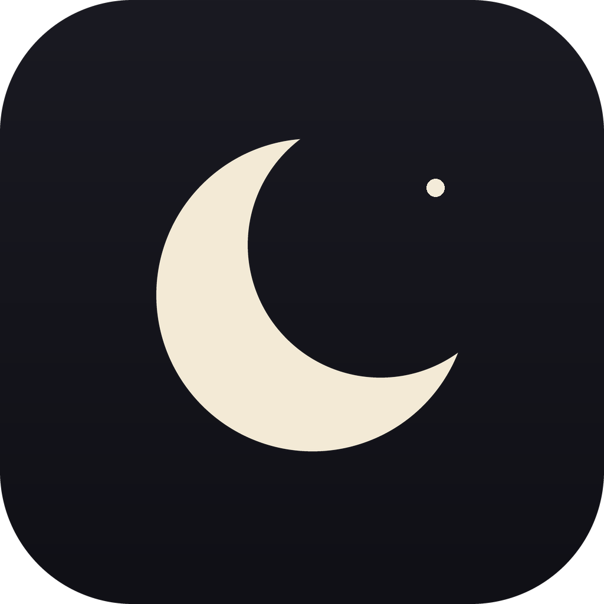

# Yamiy

<p align="center"></p>

MacBook を AI に明け渡したい、すべての人へ。
For everyone who wants to hand their MacBook over to AI.

Mac の画面を、真っ暗なまま止めずに保つメニューバーアプリです。
A menu-bar app that keeps your Mac's display physically dark — without ever putting it to sleep.


## 日本語

### これは何か

AI エージェントや自動処理を Mac で常時走らせていると、画面はつけっぱなしになります。中身を他人に見られたくない。でもディスプレイをスリープさせると、リモート操作や自動処理の都合が悪くなる場面があります。

Yamiy はその間で使います。明るさを最低に固定し、明るさキーも効かなくして、画面を物理的に真っ暗に保ちます。外部ディスプレイがつながっていれば、そちらも無効にできます。画面そのものは起きているので、キャプチャもリモート操作もそのまま動きます。本人が Touch ID でロックを解除したときだけ画面が戻り、5 分触らなければ自動で真っ暗に戻ります。フタを閉じれば、5 分を待たずその場で真っ暗になります。

### 使い方

起動するとステルス状態（真っ暗＋明るさキー無効）になります。メニューバーの三日月のアイコンを押すとメニューが開いて、現在の状態が見られます。

- 本人モードにする: Touch ID ボタンで画面をロックし、指紋で解除する
- ステルスに戻す: もう一度ロックする。フタを閉じる。または 5 分間何も触らない
- 終了する: メニューの「Yamiy を終了」。キーと明るさと外部ディスプレイは元に戻ります

メニューの「設定を開く…」からは、本人モードの明るさ、真っ暗に戻るまでの無操作時間、ログイン時に起動するかどうか、外部ディスプレイも無効にするかどうかを変更できます。

### 仕組み

- 明るさの制御には DisplayServices の私的 API を使います。単発の設定は自動調節などに押し戻されるため、0.15 秒ごとに最低へ戻し続ける「保持」方式にしています
- 明るさキーの無効化は二重です。内蔵キーボードの明るさキーは `hidutil` のリマップをすり抜けるイベントで届くため、イベントタップで受けて捨てます（システム設定でのアクセシビリティ許可が必要です）。外付けキーボード向けには `hidutil` のリマップも併用します。許可がない場合でも、明るさの保持だけで画面は暗いままです
- 外部ディスプレイの無効化には SkyLight の私的 API を使います。ステルス中は外部ディスプレイをオフラインにし、つなぎ足された場合もその場で無効にします。本人モードと終了時には元に戻します
- フタの開閉は IOKit の clamshell 状態を見張ります。閉じた瞬間にステルスへ入ります
- ロック／解除の検知にはシステムの配信通知を使います

私的 API を使うため Mac App Store では配布できません。GitHub で配ります。

### インストール

[Releases](https://github.com/snowkiss13/yamiy/releases/latest) から `Yamiy-0.2.4.zip` をダウンロードして展開し、`Yamiy.app` をアプリケーションフォルダへ移すだけです。

Developer ID で署名済みですが、公証はまだ受けていないため、初回だけ Finder で右クリック → 開く を選んでください。通常のダブルクリックでは Gatekeeper に止められます。明るさキーを完全に止めるには、システム設定 → プライバシーとセキュリティ → アクセシビリティ で Yamiy を許可してください。ログイン時の自動起動は、アプリ内の設定でオンにできます。

ソースからビルドする場合（Xcode コマンドラインツールが必要です）:

```sh
./build.sh
open build/Yamiy.app
```

### 動作環境

- Apple Silicon Mac、macOS 14 以降（開発と確認は macOS 27）

## English

### What is this?

If you run AI agents or automations on your Mac around the clock, the display stays on. You do not want anyone peeking at what is on it — but putting the display to sleep gets in the way of remote control and automation.

Yamiy sits in between. It holds the brightness at zero and disables the brightness keys, so the panel is physically dark while the machine stays fully awake: screen capture and remote control keep working, because brightness and the framebuffer are independent (verified). External displays can be taken offline too. The screen comes back only when you unlock it with Touch ID, and it goes dark again by itself after five minutes without input — or the moment you close the lid.

### Usage

Yamiy starts in stealth mode: dark screen, brightness keys disabled. Clicking the crescent-moon icon in the menu bar opens a menu with the current state.

- Enter owner mode: lock the screen with the Touch ID button, then unlock with your fingerprint
- Return to stealth: lock again, close the lid — or just leave the machine alone for five minutes
- Quit: choose "Yamiy を終了" (Quit Yamiy) in the menu. Keys, brightness and external displays are restored

From "設定を開く…" (Open Settings…) in the menu you can change the owner-mode brightness, the idle time before the screen goes dark again, whether Yamiy starts at login, and whether external displays are disabled as well.

### How it works

- Brightness is controlled through the private DisplayServices API. A single set does not stick (automatic brightness drives the value back), so Yamiy re-asserts zero every 0.15 seconds
- Brightness keys are blocked twice over. On the built-in keyboard they arrive as system-defined events that bypass a `hidutil` remap, so an event tap catches and swallows them (this needs the Accessibility permission in System Settings); a `hidutil` remap also covers external keyboards. Without the permission, the brightness holding alone still keeps the screen dark
- External displays are disabled through a private SkyLight API: they go offline in stealth mode, including ones plugged in mid-stealth, and come back in owner mode and on quit
- The lid is watched through IOKit's clamshell state; closing it enters stealth immediately
- Lock and unlock are detected through the system's distributed notifications

Because it uses private APIs, Yamiy cannot be distributed on the Mac App Store. It lives here on GitHub instead.

### Install

Download `Yamiy-0.2.4.zip` from [Releases](https://github.com/snowkiss13/yamiy/releases/latest), unzip it, and move `Yamiy.app` to your Applications folder.

The app is signed with a Developer ID but not notarized yet, so on first launch, right-click the app in Finder and choose Open: Gatekeeper stops a plain double-click. To fully block the brightness keys, allow Yamiy under System Settings → Privacy & Security → Accessibility. Launch at login can be enabled in the app's settings.

Or build from source (requires the Xcode command line tools):

```sh
./build.sh
open build/Yamiy.app
```

### Requirements

- Apple Silicon Mac, macOS 14 or later (developed and verified on macOS 27)

## License

MIT
