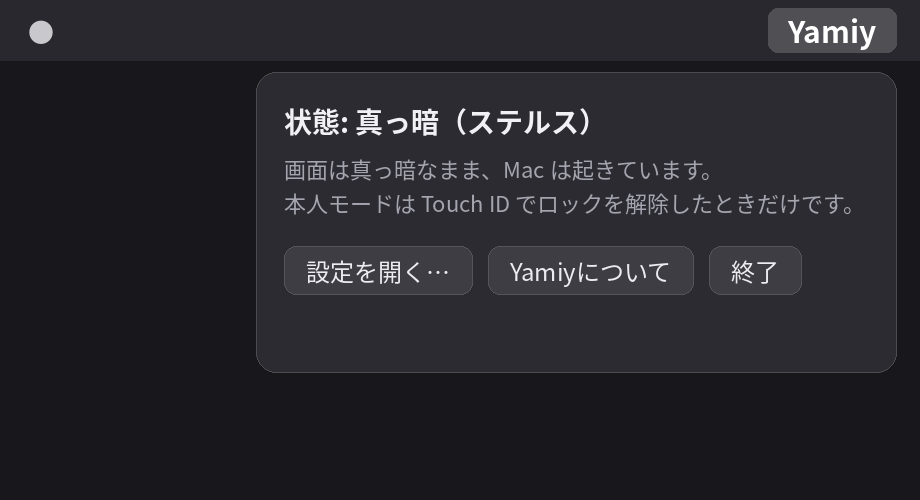

# Yamiy

Mac の画面を、真っ暗なまま止めずに保つメニューバーアプリです。
A menu-bar app that keeps your Mac's display physically dark — without ever putting it to sleep.



## 日本語

### これは何か

AI エージェントや自動処理を Mac で常時走らせていると、画面はつけっぱなしになります。中身を他人に見られたくない。でもディスプレイをスリープさせると、リモート操作や自動処理の都合が悪くなる場面があります。

Yamiy はその間で使います。明るさを最低に固定し、明るさキーも効かなくして、画面を物理的に真っ暗に保ちます。画面そのものは起きているので、キャプチャもリモート操作もそのまま動きます。本人が Touch ID でロックを解除したときだけ画面が戻り、5 分触らなければ自動で真っ暗に戻ります。

### 使い方

起動するとステルス状態（真っ暗＋明るさキー無効）になります。メニューバーの「Yamiy」を押すと小さなパネルが開いて、現在の状態が見られます。

- 本人モードにする: Touch ID ボタンで画面をロックし、指紋で解除する
- ステルスに戻す: もう一度ロックする。または 5 分間何も触らない
- 終了する: パネルの「終了」。キーと明るさは元に戻ります

パネルの「設定を開く…」からは、本人モードの明るさ、真っ暗に戻るまでの無操作時間、ログイン時に起動するかどうかを変更できます。

### 仕組み

- 明るさの制御には DisplayServices の私的 API を使います。単発の設定は自動調節などに押し戻されるため、0.15 秒ごとに最低へ戻し続ける「保持」方式にしています
- 明るさキーの無効化には `hidutil` のキーリマップを使います。キーを入口で「何も起きないキー」に付け替えるので、押しても一瞬たりとも画面は光りません
- ロック／解除の検知にはシステムの配信通知を使います。特別な権限は要りません

私的 API を使うため Mac App Store では配布できません。GitHub で配ります。

### インストール

ソースからビルドします（Xcode コマンドラインツールが必要です）。

```sh
./build.sh
open build/Yamiy.app
```

ログイン時に自動で起動させたい場合は、`build/Yamiy.app` をアプリケーションフォルダに置いて、システム設定 → 一般 → ログイン項目 に追加してください。

署名していないビルドは初回起動時に Gatekeeper で止められます。その場合は Finder で右クリック → 開く を選んでください。

### 動作環境

- Apple Silicon Mac、macOS 14 以降（開発と確認は macOS 27）

## English

### What is this?

If you run AI agents or automations on your Mac around the clock, the display stays on. You do not want anyone peeking at what is on it — but putting the display to sleep gets in the way of remote control and automation.

Yamiy sits in between. It holds the brightness at zero and disables the brightness keys, so the panel is physically dark while the machine stays fully awake: screen capture and remote control keep working, because brightness and the framebuffer are independent (verified). The screen comes back only when you unlock it with Touch ID, and it goes dark again by itself after five minutes without input.

### Usage

Yamiy starts in stealth mode: dark screen, brightness keys disabled. Clicking "Yamiy" in the menu bar opens a small panel with the current state.

- Enter owner mode: lock the screen with the Touch ID button, then unlock with your fingerprint
- Return to stealth: lock again — or just leave the machine alone for five minutes
- Quit: press "終了" (Quit) in the panel. Keys and brightness are restored

From "設定を開く…" (Open Settings…) in the panel you can change the owner-mode brightness, the idle time before the screen goes dark again, and whether Yamiy starts at login.

### How it works

- Brightness is controlled through the private DisplayServices API. A single set does not stick (automatic brightness drives the value back), so Yamiy re-asserts zero every 0.15 seconds
- Brightness keys are disabled with a `hidutil` key remap: the keys are rewired to a no-op at the input layer, so pressing them does not light the screen even for a moment
- Lock and unlock are detected through the system's distributed notifications. No special permissions are required

Because it uses a private API, Yamiy cannot be distributed on the Mac App Store. It lives here on GitHub instead.

### Install

Build from source (requires the Xcode command line tools):

```sh
./build.sh
open build/Yamiy.app
```

To start Yamiy at login, move `build/Yamiy.app` to your Applications folder and add it under System Settings → General → Login Items.

The build is unsigned, so Gatekeeper will stop the first launch. Right-click the app in Finder and choose Open.

### Requirements

- Apple Silicon Mac, macOS 14 or later (developed and verified on macOS 27)

## License

MIT
